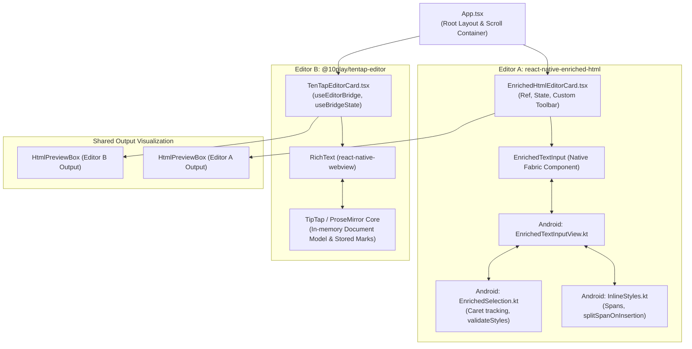

# Architecture & Code Flow: Rich Text Editor Comparison App

This document breaks down the major code files, their responsibilities block-by-block, and how data and events flow between the React Native UI, the native Android bridge, and the WebView layer.

---

## 1. System Architecture Diagram

---

## 2. Block-by-Block File Breakdown

### [`App.tsx`](file:///home/himoneesh-sharma/Downloads/workspace/us-text-editor-demo-app/App.tsx)
The application entry point and master layout manager.

* **Lines 15–29 (`SafeAreaProvider` & `ScrollView` Setup):**
  * Configures edge insets for notches/navigation bars.
  * Wraps children in a `KeyboardAvoidingView` and `ScrollView` with `keyboardShouldPersistTaps="handled"`, preventing the soft keyboard from dismissing when tapping toolbar buttons.
* **Lines 30–53 (App Header & Evaluation Chips):**
  * Displays the comparison goal and target testing chips (Typing Fluidity, Trailing Space, Toggle States, Caret).
* **Lines 55–60 (Editor Mounting):**
  * Stacks `<EnrichedHtmlEditorCard />` and `<TenTapEditorCard />` vertically on the same scrollable canvas.
* **Lines 61–82 (Physical Device Testing Checklist):**
  * Renders a persistent on-device testing guide highlighting key manual verification steps.

---

### [`EnrichedHtmlEditorCard.tsx`](file:///home/himoneesh-sharma/Downloads/workspace/us-text-editor-demo-app/src/components/EnrichedHtmlEditorCard.tsx)
Encapsulates **Editor A** (Software Mansion's pure native implementation).

* **Lines 18–28 (State & Ref Initialization):**
  * `editorRef`: Direct imperative ref (`EnrichedTextInputInstance`) used to call native methods.
  * `html`: Stores raw generated HTML string from native text watcher events.
  * `activeState`: Holds native `OnChangeStateEvent` emitted whenever cursor moves or styles change.
  * `isBold`, `isItalic`, `isStrike`, etc.: Boolean flags derived directly from `activeState` to highlight toolbar buttons without any custom JS shadow state machines.
* **Lines 46–136 (Native Toolbar Block):**
  * 6 persistent action buttons (Bold, Italic, Underline, Strikethrough, H1, Bullet List).
  * Directly triggers native commands: `editorRef.current?.toggleBold()`, `toggleStrikeThrough()`, `toggleHeading(1)`, etc.
* **Lines 138–156 (Native `<EnrichedTextInput>` Component):**
  * Renders the native `EditText` (Android) / `UITextView` (iOS).
  * `onChangeState`: Dispatches native cursor formatting changes to update button highlights.
  * `onChangeHtml`: Emits real-time HTML string whenever character spans mutate.
* **Lines 157–163 (Live HTML Visualizer):**
  * Passes generated `html` down to `<HtmlPreviewBox />`.

---

### [`TenTapEditorCard.tsx`](file:///home/himoneesh-sharma/Downloads/workspace/us-text-editor-demo-app/src/components/TenTapEditorCard.tsx)
Encapsulates **Editor B** (10Tap's WebView-hosted TipTap engine).

* **Lines 14–26 (Bridge Initialization & Subscriptions):**
  * `useEditorBridge`: Initializes the TipTap web engine inside a hidden/visible WebView with dynamic height enabled.
  * `useBridgeState(editor)`: Reactive hook subscribing to web-side editor state changes.
  * `useEditorContent(editor, { type: 'html' })`: Real-time subscription to the ProseMirror document serialized as HTML.
* **Lines 28–34 (Active Marks & Nodes Extraction):**
  * Extracts formatting state (`isBoldActive`, `isStrikeActive`, `headingLevel === 1`, etc.) from the bridge state.
* **Lines 51–142 (Direct Horizontal Toolbar):**
  * Provides a unified 6-button toolbar matching Editor A.
  * Unlike 10Tap's default `<Toolbar />` (which replaces the entire bar with H1–H6 submenus), this custom bar keeps Bold, Italic, Underline, and Heading 1 visible at all times.
  * Invokes bridge methods: `editor.toggleBold()`, `editor.toggleStrike()`, `editor.toggleHeading(1)`.
* **Lines 144–157 (`<RichText editor={editor} />` Surface):**
  * Renders the `react-native-webview` component hosting the TipTap HTML/DOM bundle.
* **Lines 159–165 (Live HTML Visualizer):**
  * Passes TipTap's HTML output to `<HtmlPreviewBox />`.

---

### [`HtmlPreviewBox.tsx`](file:///home/himoneesh-sharma/Downloads/workspace/us-text-editor-demo-app/src/components/HtmlPreviewBox.tsx)
Shared debugging and inspection utility used by both editor cards.

* **Lines 10–17 (Metrics Calculation):**
  * Computes total string length (`charCount`).
  * Uses regex `/<[^>]+>/g` to count total HTML tags (`tagCount`), providing instant feedback on tag nesting or tag bloat.
* **Lines 19–37 (Monospace Code Surface):**
  * Renders the raw HTML string inside a dark monospace container with `selectable` enabled for copying strings to clipboard.

---

## 3. Underlying Native Core (Behind Editor A)

### [`InlineStyles.kt`](file:///home/himoneesh-sharma/Downloads/workspace/us-text-editor-demo-app/node_modules/react-native-enriched-html/android/src/main/java/com/swmansion/enriched/textinput/styles/InlineStyles.kt)
Handles the application and manipulation of Android `Spannable` spans.

* **Lines 13–46 (`setSpan`):**
  * Measures boundary overlap with adjacent spans and assigns `EnrichedInputSpan` to `Spannable` with priority flags.
* **Lines 105–145 (`afterTextChanged`):**
  * Fired on every keystroke by `EnrichedTextWatcher`.
  * If cursor moved forward (`endCursorPosition > startCursorPosition`) and a style is inactive, calls `splitSpanOnInsertion`.
* **Lines 164–186 (`toggleStyle`):**
  * If selection is collapsed (`start == end`), updates `spanState.setStart(name, null)` or marks the start index for upcoming input.
* **Lines 188–213 (`splitSpanOnInsertion`):**
  * Responsible for splitting spans when inserting characters. **(Root location of the trailing-space/word-unstriking glitch)**.

---

### [`EnrichedSelection.kt`](file:///home/himoneesh-sharma/Downloads/workspace/us-text-editor-demo-app/node_modules/react-native-enriched-html/android/src/main/java/com/swmansion/enriched/textinput/utils/EnrichedSelection.kt)
Handles caret position tracking, zero-width space handling, and toolbar state synchronization.

* **Lines 26–61 (`onSelection`):**
  * Receives `(selStart, selEnd)` from Android `EditText`.
  * Normalizes coordinates, handles zero-width space shifts, and calls `validateStyles()`.
* **Lines 84–115 (`validateStyles`):**
  * Iterates across all inline, paragraph, and list styles, checking if the caret is currently inside any span.
* **Lines 122–140 (`getInlineStyleStart`):**
  * Queries spans under the cursor. Uses `start >= spanStart && end <= spanEnd` to detect if the current cursor touches an active span.

---

## 4. Architectural Comparison Summary

| Metric | Editor A: `react-native-enriched-html` | Editor B: `@10play/tentap-editor` |
| :--- | :--- | :--- |
| **Rendering Engine** | Native Android `EditText` / iOS `UITextView` | Chromium/WebKit (`react-native-webview`) |
| **Document Model** | Android `SpannableStringBuilder` directly | ProseMirror in-memory document tree |
| **Typing Latency** | **Near 0 ms** (direct OS input thread) | ~10–30 ms (IPC bridge between WebView & React) |
| **Formatting Toggles** | Slices/merges mutable native spans (`InlineStyles.kt`) | Immutable Stored Marks model (clean boundary separation) |
| **Bold Appearance** | Depends on native `Typeface` (no faux-bold fallback) | Automatic CSS font-weight outline synthesis |
| **HTML Serialization** | Native Kotlin/Java parser (`EnrichedParser.java`) | TipTap web serializer (`prosemirror-model`) |

